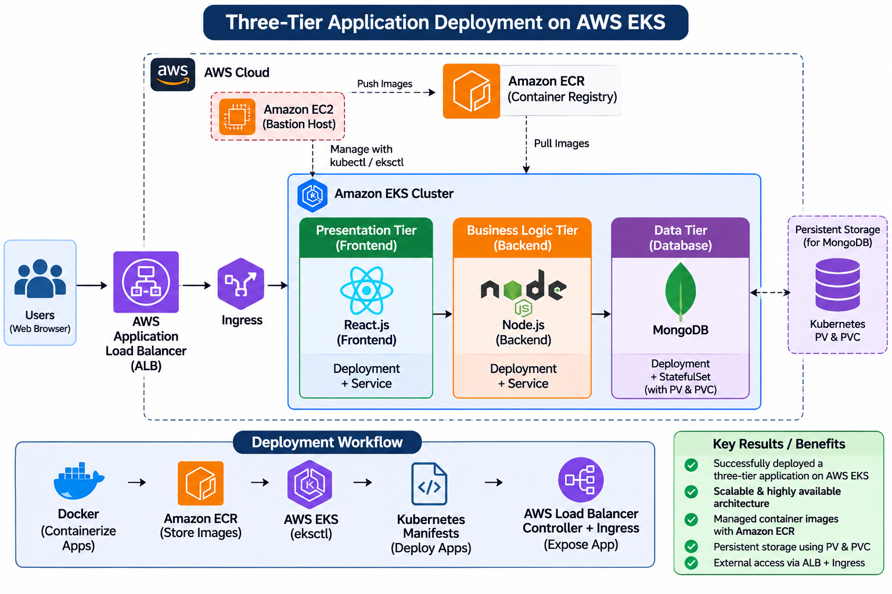

# Three-Tier Application Deployment on AWS EKS

## Project Overview

This project demonstrates the deployment of a three-tier web application on Amazon EKS using Docker, Jenkins, Terraform, and Kubernetes.

The application consists of:
- Frontend: React.js
- Backend: Node.js
- Database: MongoDB

## Architecture

## Technologies Used

- AWS (EKS, EC2, ECR, ALB)
- Docker
- Kubernetes
- Jenkins
- Terraform
- React.js
- Node.js
- MongoDB
- Helm
- Linux

## Project Structure

Three-Tier-Application-Deployment-on-AWS-EKS/
│
├── Application-Code/
├── Jenkins-Pipeline-Code/
├── Jenkins-Server-TF/
├── Kubernetes-Manifests-file/
├── assets/
├── three-tier-architecture.png
└── README.md

## Deployment Workflow

1. Provision AWS infrastructure using Terraform.
2. Set up Jenkins for CI/CD automation.
3. Build Docker images for the frontend and backend.
4. Push container images to Amazon ECR.
5. Deploy the application on Amazon EKS using Kubernetes manifests.
6. Configure AWS Load Balancer Controller and Ingress for external access.
7. Configure persistent storage for MongoDB using Kubernetes PV and PVC.

## Key Features

- Three-tier application architecture.
- Containerized frontend and backend services.
- Automated CI/CD using Jenkins.
- Kubernetes-based application deployment.
- Container image management with Amazon ECR.
- Persistent database storage.
- External application access through AWS Load Balancer and Ingress.

